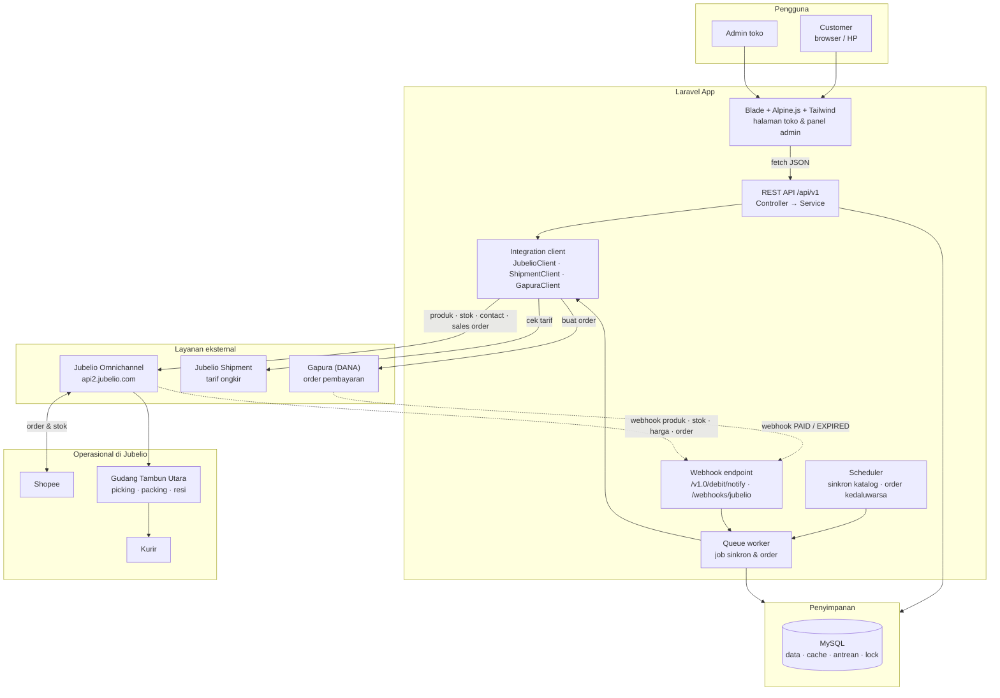
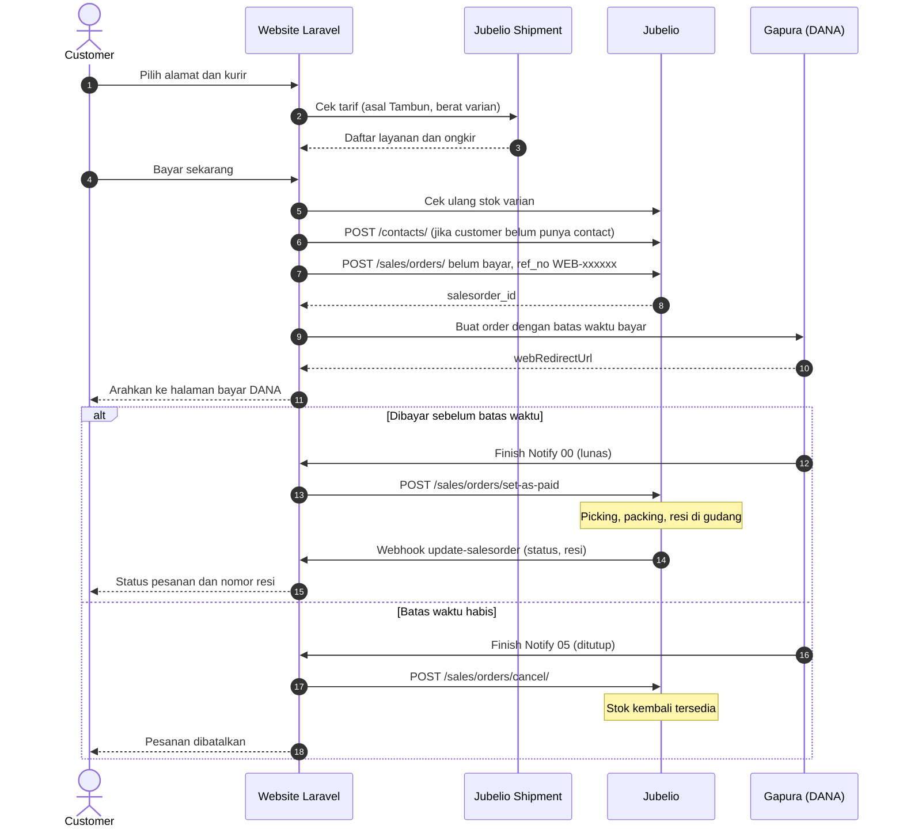

# Arsitektur Sistem — E-Commerce Saeful Askar

Laravel monolit: Blade + Alpine.js + Tailwind (FE) memanggil REST API `/api/v1` (BE). Auth session cookie (Sanctum stateful). MySQL sekaligus menjadi cache (token Jubelio, ongkir, region), antrean job, dan atomic lock lewat driver `database` Laravel — tanpa Redis.  Integrasi keluar hanya lewat `app/Services/*/...Client` (JubelioClient, JubelioShipmentClient, GapuraClient). Webhook Gapura (DANA) & Jubelio → verifikasi → `webhook_events` → job di queue (idempotent). Scheduler: sinkron katalog (malam penuh, 30 menit inkremental), rekonsiliasi stok 15 menit, batalkan order kedaluwarsa 5 menit, retry push order.

Kerja paralel: semua endpoint disiapkan sejak awal di `docs/api/*.md` (satu file Markdown per modul); FE memakai mock JSON di `resources/js/api/mocks/` (`VITE_API_MOCK=true`); BE feature test sesuai struktur JSON di kontrak dengan fixture Jubelio/Gapura. Branch Git: `backend` dan `frontend` di-merge ke `development`, lalu `development` ke `main` (rincian di PRD §8).

## Diagram arsitektur (Mermaid)


## Alur checkout & pembayaran (Mermaid)


## Struktur folder
```
saeful-askar/
├── docs/                                   BERSAMA · sumber kebenaran kontrak
│   ├── api/                                API Contract v1, satu file per modul
│   │   ├── README.md                       konvensi, objek bersama, kode error, indeks endpoint
│   │   ├── auth.md
│   │   ├── catalog.md                      kategori & produk
│   │   ├── cart.md
│   │   ├── addresses-regions.md
│   │   ├── shipping.md                     tarif Jubelio Shipment
│   │   ├── checkout-orders.md
│   │   ├── admin.md                        panel admin: pesanan, sinkron
│   │   ├── webhooks.md                     webhook masuk Gapura & Jubelio
│   │   └── integrations.md                 panggilan keluar ke Jubelio, Jubelio Shipment, Gapura
│   ├── PRD-Website-ECommerce-Saeful-Askar.md   kebutuhan produk (acuan utama)
│   ├── arsitektur-sistem.md                diagram arsitektur, alur checkout, struktur folder
│   └── erd.md                              ERD v2: kolom, relasi, index 13 tabel (pemetaan field Jubelio ada di api/integrations.md)
│
├── app/                                    BE
│   ├── Console/Commands/
│   │   ├── JubelioSyncCategories.php       php artisan jubelio:sync-categories
│   │   ├── JubelioSyncProducts.php         jubelio:sync-products {--full}
│   │   ├── JubelioReconcileStock.php
│   │   └── ExpireUnpaidOrders.php
│   ├── Enums/
│   │   ├── OrderStatus.php                 pending_payment, paid, processing, shipped, completed, cancelled, expired
│   │   ├── PaymentStatus.php
│   │   ├── UserRole.php
│   │   ├── WebhookProvider.php
│   │   └── …                           JubelioSyncStatus, OrderStatusSource, SyncType, SyncStatus, …
│   ├── Exceptions/
│   │   ├── ApiException.php                basis error format kontrak {message, code, errors}
│   │   ├── ApiExceptionRenderer.php        error Laravel (401/403/404/419/422/429/500) → kode kontrak
│   │   ├── NotImplementedException.php     501 untuk endpoint stub selama pengembangan
│   │   ├── JubelioApiException.php
│   │   └── InsufficientStockException.php
│   ├── Http/
│   │   ├── Controllers/
│   │   │   ├── Web/                        hanya me-return view Blade
│   │   │   │   ├── HomeController.php
│   │   │   │   ├── ProductPageController.php
│   │   │   │   ├── CartPageController.php
│   │   │   │   ├── CheckoutPageController.php
│   │   │   │   ├── AccountPageController.php
│   │   │   │   ├── AuthPageController.php      login, daftar, lupa/reset password
│   │   │   │   └── AdminPageController.php     halaman panel admin
│   │   │   ├── Api/V1/                     endpoint JSON sesuai docs/api/*.md
│   │   │   │   ├── AuthController.php
│   │   │   │   ├── CategoryController.php
│   │   │   │   ├── ProductController.php
│   │   │   │   ├── CartController.php
│   │   │   │   ├── AddressController.php
│   │   │   │   ├── RegionController.php        proxy + cache Region Jubelio
│   │   │   │   ├── ShippingRateController.php  tarif Jubelio Shipment
│   │   │   │   ├── CheckoutController.php
│   │   │   │   └── OrderController.php
│   │   │   ├── Admin/
│   │   │   │   ├── OrderController.php
│   │   │   │   └── SyncController.php          tombol sinkron manual + log
│   │   │   └── Webhook/
│   │   │       ├── GapuraWebhookController.php
│   │   │       └── JubelioWebhookController.php
│   │   ├── Middleware/
│   │   │   ├── EnsureUserIsAdmin.php
│   │   │   ├── RequirePageRole.php         guard halaman Blade (dilewati saat VITE_API_MOCK=true)
│   │   │   └── RejectMalformedJson.php     body JSON rusak → 400 BAD_REQUEST
│   │   ├── Requests/Api/V1/                StoreAddressRequest, AddCartItemRequest, CheckoutRequest, …
│   │   └── Resources/Api/V1/               ProductResource, ProductDetailResource, VariantResource, OrderResource, …
│   ├── Jobs/
│   │   ├── Jubelio/
│   │   │   ├── SyncProductGroupJob.php
│   │   │   ├── SyncStockJob.php
│   │   │   ├── PushSalesOrderJob.php
│   │   │   ├── MarkSalesOrderPaidJob.php
│   │   │   └── CancelSalesOrderJob.php
│   │   └── Webhooks/
│   │       ├── ProcessJubelioWebhookJob.php
│   │       └── ProcessGapuraWebhookJob.php
│   ├── Models/                             User, Address, Category, Product, ProductVariant, ProductImage, CartItem,
│   │                                       Order, OrderItem, Payment, OrderStatusHistory, WebhookEvent, SyncLog
│   ├── Policies/
│   │   ├── AddressPolicy.php
│   │   └── OrderPolicy.php
│   ├── Services/
│   │   ├── IntegrationClient.php           timeout, log, retry bersama semua client (INT-HDL)
│   │   ├── Jubelio/
│   │   │   ├── JubelioClient.php           satu-satunya pemanggil api2.jubelio.com
│   │   │   ├── JubelioTokenManager.php     token 11,5 jam di cache database
│   │   │   ├── ProductSyncService.php
│   │   │   ├── StockSyncService.php
│   │   │   ├── ContactService.php
│   │   │   ├── SalesOrderService.php
│   │   │   ├── RegionService.php
│   │   │   └── Mappers/
│   │   │       ├── ProductMapper.php
│   │   │       └── SalesOrderPayloadBuilder.php
│   │   ├── JubelioShipment/
│   │   │   ├── JubelioShipmentClient.php
│   │   │   └── ShippingRateService.php
│   │   ├── Gapura/
│   │   │   ├── GapuraClient.php            satu-satunya pemanggil DANA, membungkus SDK danaid/dana-php
│   │   │   ├── GapuraStatus.php            kode status DANA → PaymentStatus
│   │   │   └── GapuraOrder · GapuraPayment · GapuraNotification   DTO hasil
│   │   ├── Webhooks/
│   │   │   └── WebhookReceiver.php         verifikasi token/signature → webhook_events → queue
│   │   └── Shop/
│   │       ├── CartService.php
│   │       ├── CheckoutService.php         orkestrasi stok → SO → order Gapura dalam satu alur
│   │       └── OrderNumberGenerator.php    WEB-000123
│   └── Providers/AppServiceProvider.php
│
├── bootstrap/app.php                       BE · daftar route web, api, webhooks; middleware; CSRF exception untuk webhook
├── config/                                 BE
│   ├── jubelio.php                         base_url, email, password, store_id, location_id, tax_id, webhook_secret
│   ├── jubelio_shipment.php                client_id, client_secret, origin, environment
│   └── gapura.php                          env, client_id, merchant_id, private_key_path, mcc, notify_url, payment_duration
│
├── database/                               BE
│   ├── migrations/                         13 tabel sesuai docs/erd.md
│   ├── factories/
│   └── seeders/
│       ├── DatabaseSeeder.php
│       ├── AdminUserSeeder.php
│       └── DemoCatalogSeeder.php           data contoh untuk FE saat Jubelio belum terhubung
│
├── resources/                              FE
│   ├── css/app.css                         Tailwind 4 (@import 'tailwindcss')
│   ├── js/
│   │   ├── app.js                          inisialisasi Alpine, registrasi komponen
│   │   ├── api/
│   │   │   ├── client.js                   fetch wrapper: CSRF, JSON, error format kontrak
│   │   │   ├── endpoints.js                semua path /api/v1 di satu tempat
│   │   │   └── mocks/                      contract.json (hasil npm run mocks:generate) + overrides.js, aktif bila VITE_API_MOCK=true
│   │   ├── stores/
│   │   │   ├── cart.js                     Alpine.store('cart'): badge, total
│   │   │   └── auth.js
│   │   ├── utils/format.js                 rupiah, berat, tanggal (juga $format di Alpine)
│   │   └── components/
│   │       ├── productList.js              cari, filter kategori, paginasi
│   │       ├── productDetail.js            pilih varian, cek stok, tambah ke keranjang
│   │       ├── cartPage.js
│   │       ├── addressForm.js
│   │       ├── regionPicker.js             provinsi → kota → kecamatan → kelurahan
│   │       ├── shippingOptions.js
│   │       ├── checkout.js
│   │       └── orderTracking.js
│   └── views/
│       ├── layouts/
│       │   ├── app.blade.php
│       │   └── admin.blade.php
│       ├── partials/mock-banner.blade.php  penanda mode mock
│       ├── components/                     x-product-card, x-price, x-stock-badge, x-variant-picker, x-pagination, …
│       ├── pages/
│       │   ├── home.blade.php
│       │   ├── products/index.blade.php
│       │   ├── products/show.blade.php
│       │   ├── cart.blade.php
│       │   ├── checkout/index.blade.php
│       │   ├── checkout/finish.blade.php   halaman kembali dari DANA
│       │   ├── account/orders/index.blade.php
│       │   ├── account/orders/show.blade.php
│       │   ├── account/addresses.blade.php
│       │   └── auth/login.blade.php · register.blade.php
│       └── admin/
│           ├── orders/index.blade.php
│           └── sync/index.blade.php
│
├── routes/                                 BERSAMA · web.php milik FE, api.php & webhooks.php milik BE
│   ├── web.php                             halaman Blade
│   ├── api.php                             prefix /api/v1
│   ├── webhooks.php                        /webhooks/jubelio
│   ├── gapura.php                          /v1.0/debit/notify (WH-01, path ditetapkan DANA)
│   └── console.php                         jadwal sinkron & pembatalan
│
├── tests/                                  BE (wajib)
│   ├── Feature/
│   │   ├── Api/V1/                         tes tiap endpoint sesuai docs/api/*.md
│   │   ├── Checkout/CheckoutFlowTest.php
│   │   └── Webhooks/                       PAID, EXPIRED, update-qty, idempotensi
│   ├── Unit/Services/Jubelio/              mapper & payload builder
│   └── Fixtures/
│       ├── jubelio/                        contoh response & webhook dari spec
│       └── gapura/
│
├── lang/id/                                BERSAMA · pesan validasi & auth Bahasa Indonesia
├── scripts/generate-api-mocks.mjs          BERSAMA · docs/api → resources/js/api/mocks/contract.json
├── public/  storage/  vendor/
├── .env.example
├── README.md                               cara setup lokal & alur branch
├── composer.json
├── package.json                            alpinejs, tailwindcss, vite
└── vite.config.js
```
