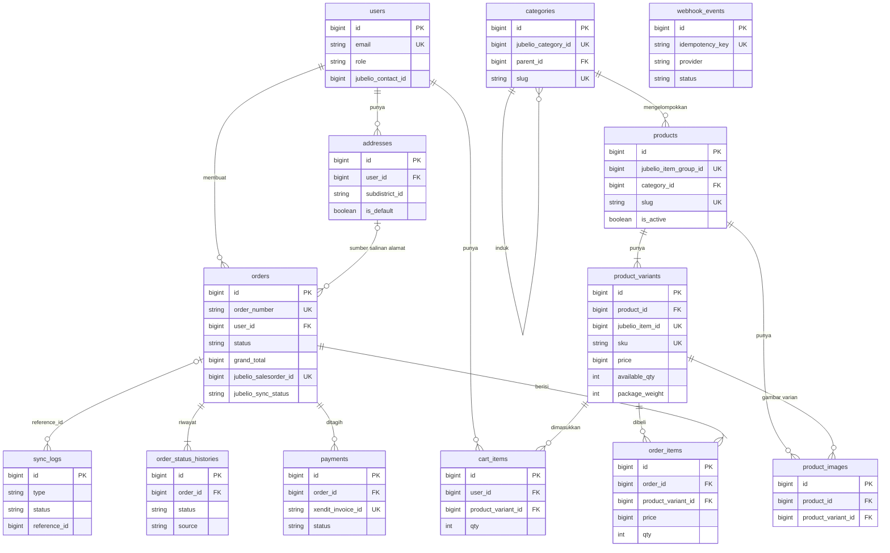

# ERD v2 — Website E-Commerce Saeful Askar

15 Oktober 2026 · Status: **Draft untuk direview** · Disusun dari API Contract v1 (`docs/api/*.md`) dan PRD §6

Dokumen ini menjabarkan 13 tabel aplikasi sampai level kolom, sebagai acuan migrasi di `database/migrations/`. Setiap kolom bisa ditelusuri ke field response, request, atau acceptance criteria di API Contract. Bila kontrak berubah, dokumen ini ikut diperbarui di commit yang sama.

## Konvensi

| Hal | Aturan |
| --- | --- |
| Primary key | `id` BIGINT UNSIGNED auto increment |
| Foreign key | `<tabel_tunggal>_id`, BIGINT UNSIGNED, selalu ber-index |
| Uang | BIGINT UNSIGNED, rupiah tanpa desimal (README: aturan data) |
| Berat | INT UNSIGNED, gram |
| Dimensi | SMALLINT UNSIGNED, cm |
| Waktu | TIMESTAMP, zona aplikasi `Asia/Jakarta`; response diformat ISO 8601 `+07:00` |
| Enum | VARCHAR + PHP Enum di `app/Enums/` (bukan ENUM MySQL, agar menambah nilai tidak perlu ALTER) |
| ID Jubelio | Kolom berawalan `jubelio_`, UNIQUE bila mewakili satu baris Jubelio |
| ID Region Jubelio | VARCHAR (string), panjang mengikuti `addresses-regions.md` |
| Charset | `utf8mb4_unicode_ci` |

## Diagram

## Kelompok Akun

### `users`

Tabel bawaan Laravel yang diperluas. Acuan: `auth.md` (objek User), INT-JB-09.

| Kolom | Tipe | Null | Default | Keterangan |
| --- | --- | --- | --- | --- |
| `id` | BIGINT UNSIGNED | — | auto | PK |
| `name` | VARCHAR(100) | Tidak | — | 2–100 karakter (AUTH-02) |
| `email` | VARCHAR(191) | Tidak | — | UNIQUE, disimpan huruf kecil |
| `phone` | VARCHAR(15) | Ya | NULL | Format `08…`. Null hanya untuk admin hasil seeder; checkout menolak `PROFILE_INCOMPLETE` bila kosong |
| `role` | VARCHAR(20) | Tidak | `customer` | Enum `UserRole`: `customer`, `admin` |
| `jubelio_contact_id` | BIGINT UNSIGNED | Ya | NULL | Diisi saat checkout pertama (INT-JB-09). Tidak pernah dikirim ke frontend |
| `email_verified_at` | TIMESTAMP | Ya | NULL | Bawaan Laravel |
| `password` | VARCHAR(255) | Tidak | — | Hash bcrypt |
| `remember_token` | VARCHAR(100) | Ya | NULL | `remember = true` (AUTH-03) |
| `created_at`, `updated_at` | TIMESTAMP | Ya | — | |

Index: UNIQUE `email`; INDEX `jubelio_contact_id`.

### `addresses`

Acuan: `addresses-regions.md` (objek Address, ADDR-01 – ADDR-06).

| Kolom | Tipe | Null | Default | Keterangan |
| --- | --- | --- | --- | --- |
| `id` | BIGINT UNSIGNED | — | auto | PK |
| `user_id` | BIGINT UNSIGNED | Tidak | — | FK `users.id`, ON DELETE CASCADE |
| `label` | VARCHAR(50) | Ya | NULL | "Rumah", "Kantor" |
| `recipient_name` | VARCHAR(100) | Tidak | — | |
| `phone` | VARCHAR(15) | Tidak | — | |
| `address_line` | VARCHAR(255) | Tidak | — | Jalan, nomor, RT/RW, patokan |
| `province_id` | VARCHAR(2) | Tidak | — | ID Region Jubelio |
| `province_name` | VARCHAR(100) | Tidak | — | Diisi backend dari data region |
| `city_id` | VARCHAR(4) | Tidak | — | |
| `city_name` | VARCHAR(100) | Tidak | — | |
| `district_id` | VARCHAR(6) | Tidak | — | |
| `district_name` | VARCHAR(100) | Tidak | — | |
| `subdistrict_id` | VARCHAR(10) | Tidak | — | |
| `subdistrict_name` | VARCHAR(100) | Tidak | — | |
| `post_code` | CHAR(5) | Tidak | — | |
| `is_default` | BOOLEAN | Tidak | `false` | Tepat satu `true` per user (dijaga di transaksi, bukan constraint) |
| `created_at`, `updated_at` | TIMESTAMP | Ya | — | |

Index: (`user_id`, `is_default`). Batas 10 alamat per user dijaga di aplikasi (`ADDRESS_LIMIT_REACHED`).

## Kelompok Katalog (salinan Jubelio)

Website tidak pernah mengubah data katalog selain lewat sinkron. Baris tidak dihapus saat hilang dari Jubelio; cukup `is_active = false` agar order lama tetap terbaca (WH-02).

### `categories`

Acuan: CAT-01, INT-JB-02.

| Kolom | Tipe | Null | Default | Keterangan |
| --- | --- | --- | --- | --- |
| `id` | BIGINT UNSIGNED | — | auto | PK |
| `jubelio_category_id` | BIGINT UNSIGNED | Tidak | — | UNIQUE |
| `parent_id` | BIGINT UNSIGNED | Ya | NULL | FK `categories.id`, ON DELETE SET NULL. Jubelio `parent_id = 0` → NULL |
| `name` | VARCHAR(150) | Tidak | — | |
| `slug` | VARCHAR(170) | Tidak | — | UNIQUE, dibuat sekali, tidak berubah saat nama berubah |
| `is_active` | BOOLEAN | Tidak | `true` | `false` = hilang di Jubelio tapi masih dipakai produk |
| `created_at`, `updated_at` | TIMESTAMP | Ya | — | |

`product_count` di CAT-01 dihitung saat query (produk aktif dengan minimal satu varian aktif), tidak disimpan.

### `products`

Satu baris = satu **item group** Jubelio. Acuan: objek ProductDetail, INT-JB-03, INT-JB-04.

| Kolom | Tipe | Null | Default | Keterangan |
| --- | --- | --- | --- | --- |
| `id` | BIGINT UNSIGNED | — | auto | PK |
| `jubelio_item_group_id` | BIGINT UNSIGNED | Tidak | — | UNIQUE |
| `category_id` | BIGINT UNSIGNED | Ya | NULL | FK `categories.id`, ON DELETE SET NULL |
| `name` | VARCHAR(255) | Tidak | — | |
| `slug` | VARCHAR(270) | Tidak | — | UNIQUE, tetap walau nama berubah (CAT-03) |
| `brand_name` | VARCHAR(100) | Ya | NULL | |
| `description_html` | LONGTEXT | Ya | NULL | Sudah disanitasi saat sinkron |
| `sell_unit` | VARCHAR(30) | Ya | NULL | Dipakai sebagai `unit` sales order |
| `min_qty` | SMALLINT UNSIGNED | Ya | NULL | Jubelio `min` |
| `max_qty` | SMALLINT UNSIGNED | Ya | NULL | Jubelio `max` |
| `package_weight` | INT UNSIGNED | Ya | NULL | Cadangan bila berat varian kosong (INT-JB-05) |
| `package_length` | SMALLINT UNSIGNED | Ya | NULL | cm |
| `package_width` | SMALLINT UNSIGNED | Ya | NULL | cm |
| `package_height` | SMALLINT UNSIGNED | Ya | NULL | cm |
| `variations` | JSON | Ya | NULL | `[{ "label": "Warna", "values": [...] }]` |
| `thumbnail_url` | VARCHAR(500) | Ya | NULL | |
| `is_active` | BOOLEAN | Tidak | `true` | `false` bila nonaktif/`sell_this = false`/dihapus di Jubelio |
| `jubelio_last_modified` | TIMESTAMP | Ya | NULL | Dasar `sort=latest` dan sinkron inkremental |
| `synced_at` | TIMESTAMP | Ya | NULL | Sinkron terakhir yang berhasil |
| `created_at`, `updated_at` | TIMESTAMP | Ya | — | |

Index: (`is_active`, `jubelio_last_modified`); `category_id`.

`price_min`, `price_max`, `total_available_qty`, `in_stock`, dan `variant_count` dihitung dari varian aktif saat query, tidak disimpan. Katalog toko kecil (puluhan produk), jadi subquery masih jauh di bawah target 500 ms. Bila katalog tumbuh ke ribuan produk, kolom ringkasan bisa ditambahkan dan diperbarui oleh job sinkron.

### `product_variants`

Satu baris = satu **SKU** Jubelio. Acuan: objek Variant, INT-JB-03 – INT-JB-06.

| Kolom | Tipe | Null | Default | Keterangan |
| --- | --- | --- | --- | --- |
| `id` | BIGINT UNSIGNED | — | auto | PK |
| `product_id` | BIGINT UNSIGNED | Tidak | — | FK `products.id`, ON DELETE CASCADE |
| `jubelio_item_id` | BIGINT UNSIGNED | Tidak | — | UNIQUE |
| `sku` | VARCHAR(100) | Tidak | — | UNIQUE, Jubelio `item_code` |
| `name` | VARCHAR(255) | Tidak | — | Nama lengkap varian |
| `variation_values` | JSON | Ya | NULL | `[{ "label": "Warna", "value": "Hitam" }]` |
| `price` | BIGINT UNSIGNED | Tidak | 0 | Harga toko website bila ada di `prices[]`, selain itu `sell_price` |
| `available_qty` | INT | Tidak | 0 | Stok tersedia gudang Tambun Utara. Signed karena Jubelio bisa negatif; ditampilkan minimal 0 |
| `package_weight` | INT UNSIGNED | Ya | NULL | gram |
| `barcode` | VARCHAR(100) | Ya | NULL | |
| `image_url` | VARCHAR(500) | Ya | NULL | |
| `is_bundle` | BOOLEAN | Tidak | `false` | |
| `is_active` | BOOLEAN | Tidak | `true` | |
| `stock_synced_at` | TIMESTAMP | Ya | NULL | Pembaruan stok terakhir (webhook/rekonsiliasi) |
| `created_at`, `updated_at` | TIMESTAMP | Ya | — | |

Index: (`product_id`, `is_active`); UNIQUE `sku`; UNIQUE `jubelio_item_id`.

### `product_images`

Acuan: `images[]` di ProductDetail, INT-JB-04.

| Kolom | Tipe | Null | Default | Keterangan |
| --- | --- | --- | --- | --- |
| `id` | BIGINT UNSIGNED | — | auto | PK |
| `product_id` | BIGINT UNSIGNED | Tidak | — | FK `products.id`, ON DELETE CASCADE |
| `product_variant_id` | BIGINT UNSIGNED | Ya | NULL | FK `product_variants.id`, ON DELETE SET NULL. Di API ditulis `variant_id` |
| `jubelio_image_id` | BIGINT UNSIGNED | Ya | NULL | |
| `url` | VARCHAR(500) | Tidak | — | Jubelio `cloud_key` |
| `thumbnail_url` | VARCHAR(500) | Ya | NULL | |
| `sort_order` | SMALLINT UNSIGNED | Tidak | 0 | Jubelio `sequence_number` |
| `created_at`, `updated_at` | TIMESTAMP | Ya | — | |

Index: (`product_id`, `sort_order`); UNIQUE (`product_id`, `jubelio_image_id`).

## Kelompok Transaksi

### `cart_items`

Acuan: `cart.md`. Keranjang **tidak** menyimpan harga atau stok; keduanya dibaca dari `product_variants` saat request.

| Kolom | Tipe | Null | Default | Keterangan |
| --- | --- | --- | --- | --- |
| `id` | BIGINT UNSIGNED | — | auto | PK |
| `user_id` | BIGINT UNSIGNED | Tidak | — | FK `users.id`, ON DELETE CASCADE |
| `product_variant_id` | BIGINT UNSIGNED | Tidak | — | FK `product_variants.id`, ON DELETE CASCADE |
| `qty` | SMALLINT UNSIGNED | Tidak | 1 | ≥ 1 |
| `created_at`, `updated_at` | TIMESTAMP | Ya | — | Urutan "terakhir ditambahkan" memakai `created_at` |

Index: UNIQUE (`user_id`, `product_variant_id`).

### `orders`

Acuan: objek OrderDetail, ORD-01 – ORD-05, WH-01, WH-05, ADM-09 – ADM-12. Alamat dan kurir adalah **salinan** saat checkout.

| Kolom | Tipe | Null | Default | Keterangan |
| --- | --- | --- | --- | --- |
| `id` | BIGINT UNSIGNED | — | auto | PK |
| `order_number` | VARCHAR(20) | Ya* | NULL | UNIQUE, `WEB-000123`. *NULL hanya sesaat di dalam transaksi checkout, sebelum nomor dibuat dari `id`. Dikirim sebagai `ref_no` Jubelio dan `external_id` Xendit |
| `user_id` | BIGINT UNSIGNED | Tidak | — | FK `users.id`, ON DELETE RESTRICT (order tidak boleh hilang) |
| `address_id` | BIGINT UNSIGNED | Ya | NULL | FK `addresses.id`, ON DELETE SET NULL. Hanya referensi; data kirim memakai kolom `shipping_*` |
| `status` | VARCHAR(20) | Tidak | `pending_payment` | Enum `OrderStatus`: `pending_payment`, `paid`, `processing`, `shipped`, `completed`, `expired`, `cancelled` |
| **Salinan alamat** | | | | |
| `shipping_recipient_name` | VARCHAR(100) | Tidak | — | |
| `shipping_phone` | VARCHAR(15) | Tidak | — | |
| `shipping_address_line` | VARCHAR(255) | Tidak | — | |
| `shipping_province_id`, `shipping_city_id`, `shipping_district_id`, `shipping_subdistrict_id` | VARCHAR(2/4/6/10) | Tidak | — | ID Region untuk sales order |
| `shipping_province`, `shipping_city`, `shipping_district`, `shipping_subdistrict` | VARCHAR(100) | Tidak | — | Nama wilayah |
| `shipping_post_code` | CHAR(5) | Tidak | — | |
| **Pengiriman** | | | | |
| `courier_code` | VARCHAR(30) | Tidak | — | Dari rate SHIP-01 |
| `courier_name` | VARCHAR(100) | Tidak | — | |
| `service_code` | VARCHAR(30) | Tidak | — | |
| `service_name` | VARCHAR(100) | Tidak | — | Dikirim sebagai `shipper` ke Jubelio |
| `service_type` | VARCHAR(20) | Tidak | — | `instant`, `same_day`, `regular`, `cargo` |
| `etd_text` | VARCHAR(30) | Ya | NULL | "3–5 hari" |
| `tracking_no` | VARCHAR(100) | Ya | NULL | Dari webhook `update-salesorder` |
| `jubelio_courier` | VARCHAR(100) | Ya | NULL | `courier` di webhook (kurir yang dipakai gudang) |
| `jubelio_shipper` | VARCHAR(100) | Ya | NULL | `shipper` di webhook |
| **Nominal** | | | | |
| `subtotal` | BIGINT UNSIGNED | Tidak | — | |
| `shipping_cost` | BIGINT UNSIGNED | Tidak | 0 | |
| `insurance_cost` | BIGINT UNSIGNED | Tidak | 0 | |
| `discount` | BIGINT UNSIGNED | Tidak | 0 | Selalu 0 di v1 (tanpa voucher) |
| `tax` | BIGINT UNSIGNED | Tidak | 0 | Selalu 0 (tanpa PPN) |
| `grand_total` | BIGINT UNSIGNED | Tidak | — | = invoice Xendit = `grand_total` sales order |
| **Status & waktu** | | | | |
| `note` | VARCHAR(255) | Ya | NULL | Catatan customer |
| `payment_expires_at` | TIMESTAMP | Ya | NULL | Dari `expiry_date` invoice |
| `paid_at` | TIMESTAMP | Ya | NULL | |
| `cancelled_at` | TIMESTAMP | Ya | NULL | Juga diisi saat `expired` |
| `cancel_reason` | VARCHAR(255) | Ya | NULL | Mis. "Batas waktu pembayaran habis" |
| `is_checkout_failed` | BOOLEAN | Tidak | `false` | `true` bila ORD-01 gagal di langkah 7/8. Disembunyikan dari ORD-02, tetap tampil di ADM-09 |
| `requires_refund` | BOOLEAN | Tidak | `false` | Ditandai saat order `paid`/`processing` dibatalkan di Jubelio (WH-05) |
| **Integrasi Jubelio** | | | | |
| `jubelio_salesorder_id` | BIGINT UNSIGNED | Ya | NULL | UNIQUE |
| `jubelio_salesorder_no` | VARCHAR(50) | Ya | NULL | `SO-000981` |
| `jubelio_sync_status` | VARCHAR(10) | Tidak | `pending` | `pending`, `synced`, `failed` |
| `jubelio_last_error` | TEXT | Ya | NULL | Pesan error terakhir, apa adanya (mis. `SQLSTATE 23505`) |
| `jubelio_last_modified` | TIMESTAMP | Ya | NULL | `last_modified` webhook terakhir yang diproses; event lebih lama diabaikan |
| `created_at`, `updated_at` | TIMESTAMP | Ya | — | |

Index: (`user_id`, `created_at`); (`status`, `payment_expires_at`) untuk job `ExpireUnpaidOrders`; `jubelio_sync_status`; `tracking_no`.

`order_number` dibuat oleh `OrderNumberGenerator` dari `id` setelah insert (`WEB-` + `id` 6 digit), sehingga berurutan dan unik tanpa tabel counter.

### `order_items`

Acuan: `items[]` di OrderDetail, INT-JB-10.

| Kolom | Tipe | Null | Default | Keterangan |
| --- | --- | --- | --- | --- |
| `id` | BIGINT UNSIGNED | — | auto | PK |
| `order_id` | BIGINT UNSIGNED | Tidak | — | FK `orders.id`, ON DELETE CASCADE |
| `product_variant_id` | BIGINT UNSIGNED | Ya | NULL | FK `product_variants.id`, ON DELETE SET NULL. Di API ditulis `variant_id` |
| `jubelio_item_id` | BIGINT UNSIGNED | Tidak | — | `item_id` sales order |
| `sku` | VARCHAR(100) | Tidak | — | Salinan |
| `product_name` | VARCHAR(255) | Tidak | — | Salinan |
| `variant_name` | VARCHAR(255) | Ya | NULL | Salinan, mis. "Hitam" |
| `image_url` | VARCHAR(500) | Ya | NULL | Salinan |
| `unit` | VARCHAR(30) | Tidak | `Unit` | `unit` sales order |
| `price` | BIGINT UNSIGNED | Tidak | — | Harga saat checkout |
| `qty` | SMALLINT UNSIGNED | Tidak | — | |
| `weight_gram` | INT UNSIGNED | Tidak | 0 | Berat **per unit** |
| `subtotal` | BIGINT UNSIGNED | Tidak | — | `price × qty` |
| `created_at`, `updated_at` | TIMESTAMP | Ya | — | |

Index: `order_id`.

### `payments`

Acuan: `payment` di OrderDetail, ORD-04, WH-01, INT-XD-01 – INT-XD-03.

| Kolom | Tipe | Null | Default | Keterangan |
| --- | --- | --- | --- | --- |
| `id` | BIGINT UNSIGNED | — | auto | PK |
| `order_id` | BIGINT UNSIGNED | Tidak | — | FK `orders.id`, ON DELETE CASCADE |
| `xendit_invoice_id` | VARCHAR(64) | Tidak | — | UNIQUE |
| `external_id` | VARCHAR(20) | Tidak | — | = `order_number` |
| `invoice_url` | VARCHAR(500) | Tidak | — | |
| `amount` | BIGINT UNSIGNED | Tidak | — | |
| `paid_amount` | BIGINT UNSIGNED | Ya | NULL | Dibandingkan dengan `amount` (WH-01) |
| `status` | VARCHAR(10) | Tidak | `PENDING` | Enum `PaymentStatus`: `PENDING`, `PAID`, `EXPIRED`. `SETTLED` dari Xendit disimpan sebagai `PAID` |
| `payment_method` | VARCHAR(50) | Ya | NULL | `BANK_TRANSFER`, `EWALLET`, … |
| `payment_channel` | VARCHAR(50) | Ya | NULL | `BCA`, `OVO`, … |
| `expires_at` | TIMESTAMP | Tidak | — | |
| `paid_at` | TIMESTAMP | Ya | NULL | |
| `created_at`, `updated_at` | TIMESTAMP | Ya | — | |

Index: `order_id`; `external_id`. Di v1 satu order punya satu invoice (ORD-04 tidak membuat invoice baru). Tabel tetap 1:N agar riwayat aman bila nanti ada pembuatan ulang invoice.

### `order_status_histories`

Acuan: `status_history` di OrderDetail, ADM-10 (`source`).

| Kolom | Tipe | Null | Default | Keterangan |
| --- | --- | --- | --- | --- |
| `id` | BIGINT UNSIGNED | — | auto | PK |
| `order_id` | BIGINT UNSIGNED | Tidak | — | FK `orders.id`, ON DELETE CASCADE |
| `status` | VARCHAR(20) | Tidak | — | Nilai `OrderStatus` |
| `source` | VARCHAR(20) | Tidak | `system` | `system`, `customer`, `admin`, `xendit`, `jubelio` |
| `note` | VARCHAR(255) | Ya | NULL | Mis. alasan batal |
| `created_at` | TIMESTAMP | Tidak | — | Field `at` di API. Tanpa `updated_at` (baris tidak pernah diubah) |

Index: (`order_id`, `created_at`).

## Kelompok Integrasi

### `webhook_events`

Acuan: `webhooks.md` (pola umum, WH-01 – WH-05). Daftar dan proses ulang lewat admin (ADM-15/16) ditunda ke v1.1, tapi tabel ini wajib sejak v1 untuk idempotensi.

| Kolom | Tipe | Null | Default | Keterangan |
| --- | --- | --- | --- | --- |
| `id` | BIGINT UNSIGNED | — | auto | PK |
| `provider` | VARCHAR(10) | Tidak | — | Enum `WebhookProvider`: `xendit`, `jubelio` |
| `event_type` | VARCHAR(50) | Tidak | — | `invoice.paid`, `invoice.expired`, `update-product`, `update-price`, `update-qty`, `update-salesorder` |
| `idempotency_key` | VARCHAR(191) | Tidak | — | UNIQUE. `xendit:{id}:{status}` / `jubelio:{action}:{sha256 body}`. Event bersignature tidak valid memakai `invalid:{uuid}` agar tidak bentrok |
| `signature_valid` | BOOLEAN | Tidak | — | |
| `status` | VARCHAR(10) | Tidak | `received` | `received`, `processed`, `ignored`, `failed` |
| `payload` | JSON | Tidak | — | Body mentah |
| `summary` | VARCHAR(255) | Ya | NULL | Mis. "SO-000981 · Shipped" |
| `error` | TEXT | Ya | NULL | |
| `attempts` | SMALLINT UNSIGNED | Tidak | 0 | Jumlah percobaan proses |
| `received_at` | TIMESTAMP | Tidak | — | |
| `processed_at` | TIMESTAMP | Ya | NULL | |
| `created_at`, `updated_at` | TIMESTAMP | Ya | — | |

Index: (`provider`, `status`, `received_at`).

### `sync_logs`

Acuan: ADM-11, ADM-13, ADM-14, INT-HDL.

| Kolom | Tipe | Null | Default | Keterangan |
| --- | --- | --- | --- | --- |
| `id` | BIGINT UNSIGNED | — | auto | PK |
| `type` | VARCHAR(20) | Tidak | — | `categories`, `products`, `stock`, `order_push`, `order_paid`, `order_cancel` |
| `trigger` | VARCHAR(10) | Tidak | `schedule` | `schedule`, `webhook`, `manual`, `checkout` |
| `status` | VARCHAR(10) | Tidak | `running` | `running`, `success`, `failed` |
| `reference_id` | BIGINT UNSIGNED | Ya | NULL | `orders.id` untuk tipe `order_*`. Tanpa FK karena polimorfik ringan |
| `items_processed` | INT UNSIGNED | Tidak | 0 | |
| `message` | TEXT | Ya | NULL | Pesan error apa adanya |
| `started_at` | TIMESTAMP | Tidak | — | |
| `finished_at` | TIMESTAMP | Ya | NULL | `duration_seconds` dihitung dari sini |
| `created_at`, `updated_at` | TIMESTAMP | Ya | — | |

Index: (`type`, `status`, `started_at`); `reference_id`. Log > 90 hari dihapus job terjadwal (ADM-14).

## Tabel bawaan Laravel (di luar 13 tabel)

| Tabel | Dipakai untuk |
| --- | --- |
| `sessions` | Session cookie (Sanctum stateful); memungkinkan "keluarkan session lain" (AUTH-07, AUTH-09) |
| `password_reset_tokens` | AUTH-08, AUTH-09 (berlaku 60 menit) |
| `cache`, `cache_locks` | Token Jubelio, rate ongkir (`rate_id` 30 menit), region 30 hari, `Idempotency-Key` checkout 24 jam, atomic lock sinkron & login Jubelio. Tanpa Redis |
| `jobs`, `job_batches`, `failed_jobs` | Queue driver `database` (webhook, sinkron, push order, email) |

Data sementara (`rate_id`, `Idempotency-Key`, token Jubelio) sengaja disimpan di cache, bukan tabel aplikasi, karena punya masa berlaku dan tidak perlu dilaporkan.

## Keputusan desain yang perlu direview

| # | Keputusan | Alasan | Alternatif |
| --- | --- | --- | --- |
| 1 | Ringkasan harga/stok produk dihitung saat query | Selalu konsisten dengan varian; katalog kecil | Kolom ringkasan di `products` diperbarui job sinkron |
| 2 | Enum disimpan VARCHAR + PHP Enum | Menambah status tidak perlu ALTER TABLE | ENUM MySQL (lebih ketat, lebih kaku) |
| 3 | `order_number` dari `id` | Berurutan & unik tanpa tabel counter | Tabel `sequences` dengan lock |
| 4 | `is_checkout_failed` sebagai kolom eksplisit | ORD-02 harus menyembunyikan order gagal; status `cancelled` saja tidak cukup membedakan | Status khusus `failed` (mengubah daftar status di kontrak) |
| 5 | `weight_gram` di `order_items` = berat per unit | Contoh di kontrak memakai qty 1, sehingga ambigu | Berat total baris |
| 6 | `available_qty` signed | Jubelio bisa mengembalikan stok negatif | Clamp ke 0 saat sinkron |
| 7 | Kolom Region panjang tetap (2/4/6/10) | Sesuai `addresses-regions.md` | VARCHAR lebih longgar bila Jubelio ternyata berbeda |
